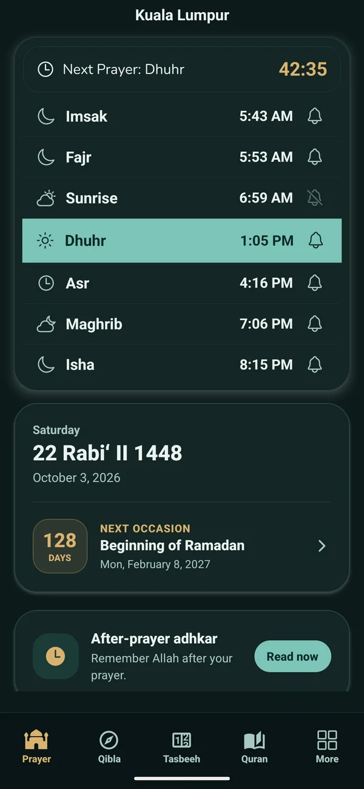
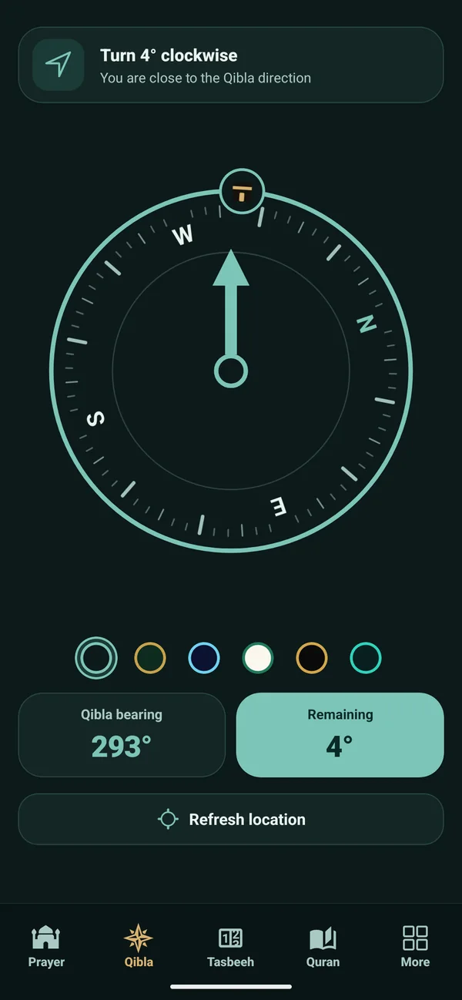
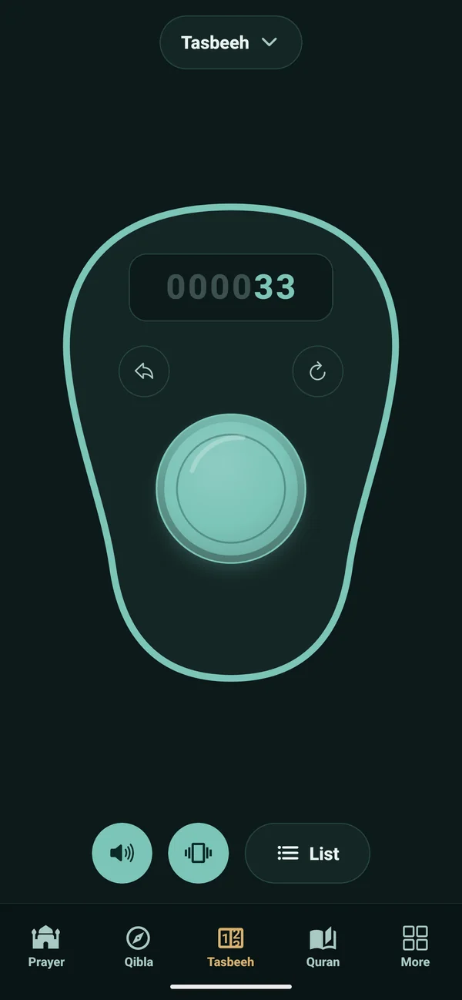
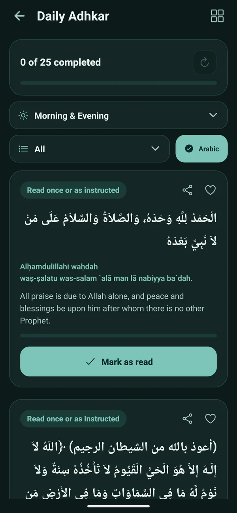
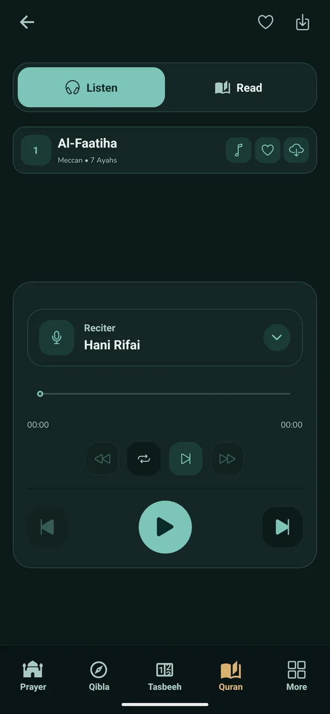
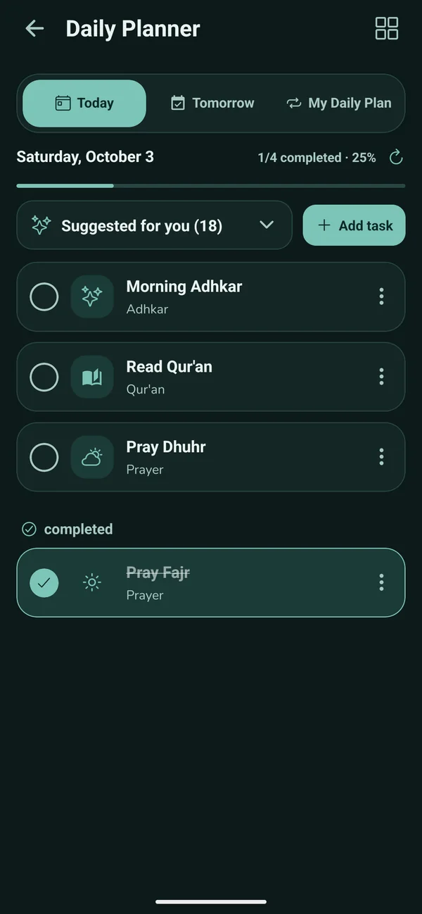
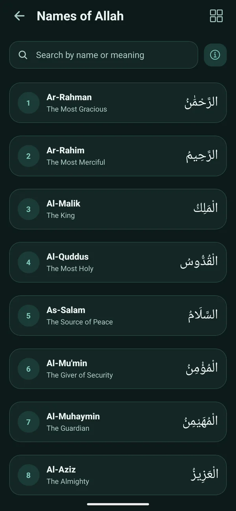
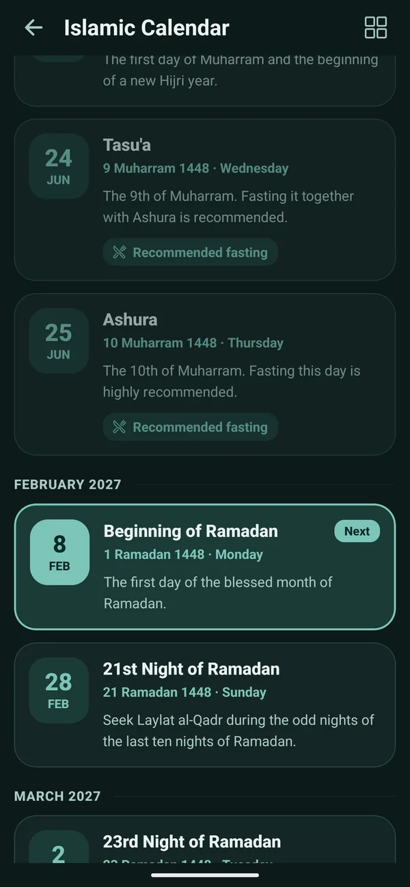

<a href="https://muslim-flow.com">
  <picture>
    <source media="(prefers-color-scheme: dark)" srcset="assets/brand/logo-dark.png">
    
  </picture>
</a>

### Your daily worship, in one calm place.

Prayer times · Quran · Adhkar · Qibla · Hijri calendar · Tasbeeh

**[Open the website](https://muslim-flow.com)** · **[Prayer times](https://muslim-flow.com/prayer-times/)** · **[Quran](https://muslim-flow.com/quran/)** · **[Qibla](https://muslim-flow.com/qibla/)** · **[Calendar](https://muslim-flow.com/calendar/)**

---

## What is Muslim Flow?

Muslim Flow is a free, calm Islamic app and website. It brings the tools you reach for every day into one place, without clutter, and keeps content based on the Quran and the authentic Sunnah.

- **The website** at **[muslim-flow.com](https://muslim-flow.com)** works in your browser on any phone or computer, with nothing to install.
- **The app** for Android is in testing and coming soon to Google Play. An iPhone and iPad version is coming soon too.

## Screenshots

 

## Features

| | |
|---|---|
| 🕌 **Prayer times** | Accurate times and adhan with a live countdown to the next prayer, for your location or any city, with the calculation method shown. |
| 📖 **Quran** | All 114 surahs with Arabic and translation, verse-by-verse audio from many reciters, and surahs you can download for offline listening. |
| 🤲 **Adhkar and duas** | Daily remembrance from Hisn al-Muslim with counters, shareable as text or as a picture. |
| 🧭 **Qibla** | A live compass for your phone, plus the bearing and distance for cities around the world. |
| 📅 **Hijri calendar** | Today's Hijri date, a month view, a converter, and upcoming occasions such as Ramadan and Eid. |
| 📿 **Tasbeeh** | A digital counter with dhikr presets, sound, vibration and your own counters. |
| ✨ **99 Names of Allah** | The names with their meanings and Quran verses. |
| 🗓️ **Daily planner** | Gentle, Muslim-friendly suggestions for your day. |

The website also has hadith with grades, Islamic questions answered from the Quran and Sunnah, stories of the prophets, a glossary, a quiz, and guides for Hajj and Umrah.

## Made to respect you

- **The app has no ads and no analytics, and needs no account.** Your settings, counters and reading position stay on your phone.
- Location is used only to work out prayer times and the Qibla direction, and it is never sold.
- **The website** is free and is supported by Google ads. See its [privacy policy](https://muslim-flow.com/privacy/) for how ads and cookies work.

## Languages

The app speaks 18 languages, with full right-to-left layouts for Arabic, Urdu and Persian: English, Arabic, Malay, Indonesian, Turkish, Urdu, Spanish, French, German, Portuguese, Russian, Bengali, Hindi, Persian, Chinese, Swahili, Hausa and Uzbek.

The website is growing in even more languages. Pick yours at [muslim-flow.com/languages](https://muslim-flow.com/languages/).

## Follow Muslim Flow

[YouTube](https://www.youtube.com/@muslimflowoffical) · [TikTok](https://www.tiktok.com/@muslimflowoffical) · [Instagram](https://www.instagram.com/muslimflowofficial/) · [Facebook](https://www.facebook.com/profile.php?id=61595063133099)

## Contact and support

Questions, ideas or a mistake to report? Use the [contact page](https://muslim-flow.com/contact/) or the [support page](https://muslim-flow.com/support/). Corrections to any text are very welcome.

## About this repository

This repository is the public home page of the project: the description, screenshots and links. The source code of the website is private.

The name, logo and screenshots are the property of the Muslim Flow project. See [LICENSE](LICENSE).

---

**[muslim-flow.com](https://muslim-flow.com)**

*May Allah accept it from all of us.*

